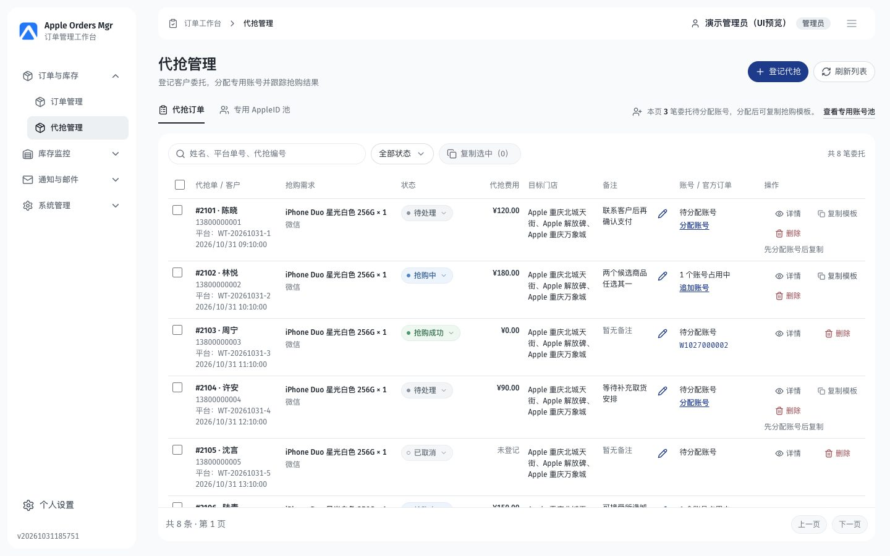
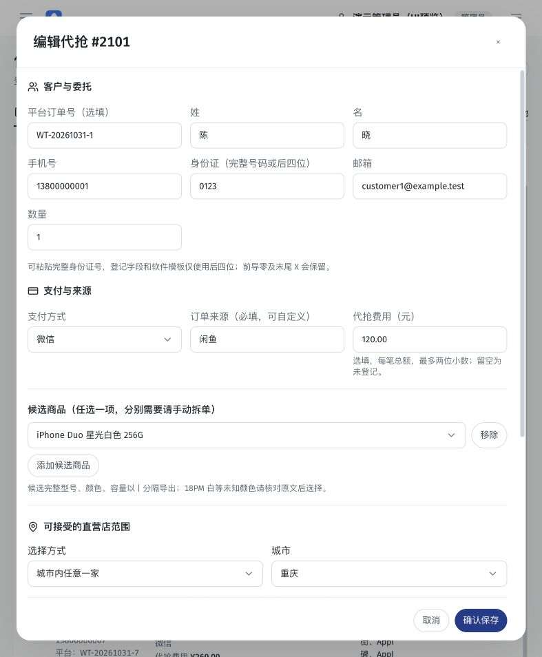

# 代抢管理页面 UI 与交互重构需求

> 版本：V1.0 · 2026-10-31
>
> 状态：当前工作树已落实并本地验收（2026-10-31）；生产与真实业务未验收。逐项结果见[本轮验收报告](../archive/2026-10/2026-10-31-代抢管理UI与费用保存验收.md)。
>
> 适用范围：`/proxy-orders` 代抢订单、专用 AppleID 池及该页内部弹窗；包含代抢费用录入与正式保存。
>
> 基线：本次用户确认的参考01灰白版，`HEAD dcf8c764d9db` 加当前未提交工作树。提交号单独不包含全部参考实现，不能直接整仓合并当前所有差异。
>
> 验证范围：依据当前源码、已确认预览、合成浏览器截图和已有隔离 PostgreSQL/API 测试整理。本次为需求和交接资料，不代表目标分支已落地、生产已迁移或真实业务已验收。

## 1. 目标与实施原则

严格复现用户确认的当前代抢工作台及全部内部交互，不重新选型配色、Logo、布局或组件风格。让工作人员在浏览器100%缩放下完成委托登记、修改、费用核对、账号分配、模板复制与结果跟踪。

**只处理代抢管理页面。订单管理、库存、监控、付款、Apple ID、取机人、通知、邮件、系统设置、登录和公开页面等 UI 保留原样。不得将本方案应用为全站主题。**

本次除 UI 与交互外，明确包含 `proxyFee` 的表单、接口和数据库保存闭环；其他业务规则、权限、账号资格、模板协议与关联规则保持。费用不能只写入前端状态、localStorage或模拟接口后就认定完成。

开发阅读顺序：第2节范围 → 第3节视觉 → 第4～10节交互 → 第11节费用保存 → 第12～14节隔离与验收 → 第15节参考资料。开发提示词见第16节。

## 2. 范围与不可越界项

| 区域                  | 处理要求                                                                                                                       |
| --------------------- | ------------------------------------------------------------------------------------------------------------------------------ |
| 代抢订单工作区        | 标题、页签、操作提示、搜索、状态筛选、选择、批量复制、主表、行内状态/备注、操作、分页及全部反馈                                |
| 专用 AppleID 池工作区 | 搜索、专用池/历史候选切换、数量、列表、选择、导入、纳入、编辑及批量状态                                                        |
| 页面内二级界面        | 登记/编辑、详情、状态确认、分配/追加、释放确认、人工关联/解除、导入、账号编辑、批量状态、取消/删除确认、通用确认及手动复制降级 |
| 费用链路              | 登记和编辑录入、前后端校验、正式Migration、保存、列表/详情回读、空值与0、失败与版本冲突                                        |
| 当前代抢路由外壳      | 复现本路由现有灰白外框、当前路由下的导航局部呈现和工作区路径；保持现有Logo、菜单结构、路由和权限                               |
| 共享菜单及全站Shell   | 不做全站重构；其他路由下的侧栏、顶栏、尺寸、颜色、字体和行为不改。必要的Layout改动必须有代抢路由条件                           |
| 其他页面              | 内容区、弹层、表格、控件、样式、响应式和业务行为全部保持，不顺带优化                                                           |
| 不在范围              | 重新设计Logo、登录页/favicon、全站字体/主题升级、新统计卡片、真实抢购、收费/收款/结算、历史费用批量补录及生产发布              |

现有其他开发工作必须保留。不得把本机全部未提交文件或历史设计稿作为本次交付直接覆盖、提交。目标分支已有费用或UI实现时先核对并复用，不重复建列或迁移。

## 3. 已确认视觉与布局

### 3.1 风格和资源

- 参考01的现代轻量CRM风格：灰白底、白色浮置导航/内容面板、柔和圆角、中性灰选中态、深色文字，蓝色用于业务链接及主要操作。
- 保留当前 `Apple Orders Mgr` 品牌、已选蓝色Logo、现有中文字体回退和 Fira Sans；账号、订单ID、模板等结构化内容可用现有 Fira Code。不得全站替换字体或新增字体加载依赖。
- 图标沿用 Lucide React；行操作采用“图标＋文字”的轻量表现，表单确认/取消等可沿用纯文字；禁止引入emoji或另一套图标库作为产品图标。
- 委托和账号均为表格/连续列表，不改成业务卡片网格；不新增顶部四张统计卡片。商品只显示文字，不添加商品图片。
- 无常驻大阴影、渐变、玻璃效果。阴影只用于确实浮起的菜单/弹窗。

### 3.2 局部颜色及尺寸

以下令牌仅用于代抢路由，与已确认截图共同作为参考。不得写成全站 `:root` 或覆盖全局同名组件。

| 项目                     | 规格                                                                           |
| ------------------------ | ------------------------------------------------------------------------------ |
| 页面底色 / 面板          | `#F3F5F7` / `#FFFFFF`                                                          |
| 次级表面 / 中性选中态    | `#F7F8FA` / `#EDF0F3`                                                          |
| 正文 / 辅助文字          | `#20262E` / `#626B76`                                                          |
| 分隔线 / 控件边框        | `#E9EDF0`、`#EFF1F3` / `#D9DEE4`                                               |
| 主要操作 / 悬停 / 浅蓝底 | `#1E3A8A` / `#172F70` / `#EFF6FF`                                              |
| 桌面页标题 / 描述        | 24px、600字重 / 13px                                                           |
| 桌面表格                 | 12px；客户标识约13px；通过字重和颜色区分主次信息                               |
| 桌面工具栏               | 字体13px，主要控件高约34px，搜索/按钮为胶囊形                                  |
| 行内状态                 | 字体12px，胶囊高至少约26px，6px状态圆点及轻量箭头                              |
| 菜单 / 弹窗              | 菜单圆角约12px；表单输入圆角约8px；桌面正文13px                                |
| 桌面路由外壳             | 1100px起：侧栏宽208px、距窗口约12px、占位232px；内容内边距24px；仅当前路由生效 |
| 手机                     | 页标题22px，输入16px，主要触控和弹窗按钮至少44px                               |

输入和按钮不出现粗重蓝色双重焦点框。鼠标点击不残留多余外描边；键盘 `focus-visible` 必须仍可见，不允许全局删除焦点样式。

### 3.3 响应式及滚动

| 条件                | 要求                                                                                                                   |
| ------------------- | ---------------------------------------------------------------------------------------------------------------------- |
| 1920/1440px桌面     | 默认列完整可读，1440px主表无需横向滚动；操作固定在右侧且不透出底层文字                                                 |
| 宽≥1100px且高≥680px | 工作区保留工具栏及分页，仅列表区域纵向滚动；较矮窗口恢复页面滚动，所有内容仍可达                                       |
| 宽640～1099px       | 收起侧栏，表格在自身容器内横向翻阅；筛选附近有左右浏览入口和边界禁用态。费用并入商品副行，不能只露出货币符号或半截金额 |
| 宽＜640px           | 同一委托重排为连续列表：标识/商品/状态/费用/操作优先，门店、账号、备注等字段仍完整可达；不丢字段，不出现整页横向滚动   |
| 宽＜768px弹层       | 全屏业务表单、可滚动正文、固定可达的操作区；下拉选项使用触控选择面板，适配可视视口和软键盘                             |
| 滚动条              | 细、低对比度，悬停反馈清楚；避免嵌套粗滚动条。短下拉完整展开，长列表才滚动；菜单高度计算包含边框                       |

320/390/768/1440/1920px都要验收，浏览器缩放100%；不得通过整页CSS缩放、缩小浏览器或隐藏必要字段“解决”布局。

## 4. 委托工作台与列表

### 4.1 页面框架

| 编号    | 要求                                                                                                                          |
| ------- | ----------------------------------------------------------------------------------------------------------------------------- |
| PAGE-01 | 标题“代抢管理”，说明“登记客户委托，分配专用账号并跟踪抢购结果”；右侧登记、刷新入口；账号页签对应主要操作为导入                |
| PAGE-02 | 两个下划线页签：代抢订单、专用 AppleID 池；保持当前工作区状态可辨认，不设计第三个工作区                                       |
| PAGE-03 | 待分配提示与页签共享上下文区域，数量从当前响应计算，文案明确“本页”；保留查看专用池入口，不假装为全库统计                      |
| PAGE-04 | 搜索、筛选、批量操作及总数收进同一个白色列表面板；分页与当前页信息在底部                                                      |
| PAGE-05 | 切换页签/范围/筛选后按既有逻辑重置页码和清理选择；默认每页30条。保留既有250ms请求节流和无编辑操作时的20秒刷新，不新增请求轮询 |

### 4.2 查询和选择

- 委托搜索覆盖当前已有姓名、平台单号、代抢编号；账号池搜索AppleID。占位文字随页签改变。
- 状态筛选为“全部状态＋四种代抢状态”，单选；不是订单管理页的多选筛选器。
- 勾选行、全选当前页、选择数量和“复制选中（N）”保持一致；不擅自增加跨页/跨筛选全选。
- 无选择、加载或操作中禁用相关按钮；翻页、搜索、刷新后不残留已经失效的选中对象。
- 分页显示真实总数和页码；首页/末页正确禁用。删除末页最后一条后，沿用现有返回有效页的处理。

### 4.3 表格字段及行操作

桌面固定列顺序：**选择 → 代抢单/客户 → 抢购需求 → 状态 → 代抢费用 → 目标门店 → 备注 → 账号/官方订单 → 操作**。

| 列            | 展示与交互                                                                                                     |
| ------------- | -------------------------------------------------------------------------------------------------------------- |
| 代抢单/客户   | 委托ID、姓名、电话、平台单号、登记时间分层；点击客户标识进入同一详情弹窗                                       |
| 抢购需求      | 规范化完整商品名、候选信息和数量；支付要求为副信息，不把费用算作商品售价                                       |
| 状态          | 四态圆点胶囊；点击轻量下拉，选择新值后进入状态确认，不先把新值当成已经保存                                     |
| 代抢费用      | 每笔总额，人民币两位小数，桌面右对齐且数字等宽；与详情共用格式；0/空值区分。中屏并入商品副行                   |
| 目标门店      | 保留实际允许门店名称和范围，多行可读；不以截图演示城市替换实际数据                                             |
| 备注          | 保留无备注状态及行内编辑入口；编辑有保存/取消、处理中和错误反馈，不覆盖其他资料                                |
| 账号/官方订单 | 清楚区分未分配、当前占用账号数、分配/追加入口及关联Apple订单，不混成系统订单状态                               |
| 操作          | 详情、复制模板、删除使用同一轻量图标＋文字体系；窄桌面可换行，不能截断。终态/未分配/无权限按既有条件展示或禁用 |

行悬停、选择态为轻微中性底色，不能盖住状态语义。长字段不撑破布局；关键完整值通过展开、详情或可达的副行保留。

## 5. 状态标签与全页下拉

| 值          | 标签与颜色语义                           |
| ----------- | ---------------------------------------- |
| `pending`   | 待处理：浅灰底、灰色实心圆点             |
| `rushing`   | 抢购中：浅蓝底、蓝色圆点                 |
| `succeeded` | 抢购成功：浅绿底、绿色圆点               |
| `cancelled` | 已取消：中性灰底、空心圆点，区别于待处理 |

状态始终有文字，不仅依赖颜色。标签、筛选选项、行内和详情使用同一套语义。

| 编号      | 下拉要求                                                                                                                |
| --------- | ----------------------------------------------------------------------------------------------------------------------- |
| SELECT-01 | 覆盖本页状态筛选/修改、支付方式、候选商品、城市、门店范围、账单参考门店、账号范围、分配账号、账号状态及批量目标状态     |
| SELECT-02 | 桌面白色浮层，当前项勾选、轻量悬停、展开箭头；宽度适合触发器和内容，当前参考最小约208px，最大不超视口；菜单避让视口边界 |
| SELECT-03 | 超过6个选项保留搜索与无匹配反馈；搜索不修改未提交表单数据；已选值和禁用选项可辨认。分配账号仍提供自动分配选项           |
| SELECT-04 | 支持方向键、Home/End、Enter、Esc及Tab；Esc关闭菜单并返回触发入口，不误关父弹窗；点外关闭，搜索输入保留正常光标操作      |
| SELECT-05 | 表单浮层位于本层弹窗的焦点/层级范围，不能被表格滚动区或弹窗正文裁切；滚动和调整窗口后重新定位                           |
| SELECT-06 | 手机使用适合触控的选择面板，保留搜索、当前选中与44px选项；关闭后焦点回到入口，页面背景不误滚动                          |
| SELECT-07 | 空选项、必填、disabled、表单重置、键盘焦点及可访问名称正确；不为了自定义外观丢失原字段的值和change语义                  |

采用代抢专属选择器或局部封装，不修改全站共用选择器的外观和行为。

## 6. 登记和编辑委托

### 6.1 登记入口

1. 点击“登记代抢”，显示客户信息粘贴区、复制客户格式、识别并预览、一键登记和手工填写入口。
2. 识别后展示可编辑资料、解析错误、默认值提醒和疑似重复提示；错误不等于已创建。重复需明确核对后继续另建。
3. 原有“一键登记”保持既有条件：可保存且无待核对重复时可直接登记；没有录入费用则保持未登记，不自动补0。需要填写费用时进入核对表单或手工填写。
4. 无可用账号仍允许保存委托，明确提示待分配；不能把自动分配失败冒充整个委托保存失败。

### 6.2 共享核对表单

登记和编辑复用同一套资料表单与校验，不另做一套缺字段的编辑UI。

| 分组       | 字段与要求                                                                                                                      |
| ---------- | ------------------------------------------------------------------------------------------------------------------------------- |
| 客户与委托 | 平台订单号（选填）、姓、名、手机、身份证完整号码/尾四位、邮箱、数量；保留合法身份证提取尾号及前导零/X规则，不在模板暴露完整号码 |
| 支付与来源 | 支付方式、订单来源、代抢费用（元）；桌面三列，手机纵排；来源可自定义；未知支付映射按既有规则核对                                |
| 候选商品   | 已核实完整商品任选列表，可增加/移除，数量为本委托数量；不同商品都需要时仍手动拆单；不把候选当成多件一起购买                     |
| 门店范围   | 城市及已有指定门店/城市范围交互；保留当前后端支持的固定门店集合，不重写为新的选店规则                                           |
| 账单信息   | 范围内参考门店、生成地址、可编辑省/市/区/街道；不能凭空补齐未知信息                                                             |
| 备注       | 仅供阅读，不作为自动抢购/匹配规则；和状态操作原因分开                                                                           |
| 操作区     | 取消/确认保存，保留处理中、重复提交防护和错误反馈；宽度不足时不遮挡输入或底部按钮                                               |

### 6.3 费用输入交互

- 标签固定为“代抢费用（元）”，位于支付与来源组；帮助说明“选填，每笔总额，最多两位小数；留空为未登记”。
- 使用适合十进制的输入方式，手机 `inputMode=decimal`；禁止因 `value || ''` 把0回填成空白。
- 登记可留空；编辑先回填服务端已存金额。精度或范围错误时关联字段说明和 `aria-invalid`，阻止保存且不发送非法请求。
- 输入过程中不静默四舍五入；服务端独立校验。成功以后按服务端规范化结果刷新列表，重开详情/编辑一致。
- 请求失败或409时保留用户输入供核对和重试，不关闭表单、不清空金额、不先显示保存成功；不得以旧版本自动覆盖服务端新值。

## 7. 详情、状态、账号和关联交互

| 编号       | 场景       | 要求                                                                                                                  |
| ---------- | ---------- | --------------------------------------------------------------------------------------------------------------------- |
| DETAIL-01  | 查看详情   | 客户/操作按钮均打开本页大弹窗。展示概览、完整商品/门店、支付及费用、账号历史、关联Apple订单、客户原文和操作记录       |
| DETAIL-02  | 费用和状态 | 费用与列表读取同一proxyFee及格式函数；状态文字/颜色一致，详情保留调整入口                                             |
| DETAIL-03  | 编辑资料   | 从详情进入共用表单，保持已有费用、候选、门店等实际值，不用列表摘要拼出残缺编辑资料                                    |
| STATE-01   | 调整四态   | 显示目标状态、说明及确认/返回；本次说明不覆盖客户原备注；接口成功后刷新，失败保持确认界面及旧状态事实                 |
| STATE-02   | 取消无占用 | 说明当前无占用，可确认取消；返回不写入                                                                                |
| STATE-03   | 取消有占用 | 明确先停止外部软件，勾选确认前禁用提交；服务端再校验，新增占用/409提示时补充确认，不绕过                              |
| ASSIGN-01  | 分配/追加  | 显示真实可分配数，0与未知区分；可手选或自动分配，自动数量1–20且不超实际可用数；长选项支持搜索                         |
| ASSIGN-02  | 空池/失败  | 解释禁用原因，保留前往账号池入口；查询失败不显示0；分配失败保留选择、数量和错误，不假成功                             |
| RELEASE-01 | 释放账号   | 必须明确确认外部任务已经停止；保留历史，不能把释放占用与更改账号状态/取消整个委托混为一个新动作                       |
| LINK-01    | 人工关联   | 输入Apple订单号和核对原因；保留现有客户、账号、时间及商品核对和幂等约束；符合条件的新关联可自动成功，已取消单只补记录 |
| LINK-02    | 解除误关联 | 明确目标官方订单及原因；保留历史，解除后不自动关联回来；不新增付款/取货/退款处理                                      |

关联Apple订单展示系统ID、订单号、官网采集状态、商品及现有门店/观测时间。未采集保持未知，不能用邮件状态冒充官网状态。人工恢复、晚到关联及官网后续变化继续执行现有API契约，UI不私自推导代抢状态。

## 8. 复制、备注和删除

| 编号      | 要求                                                                                                                                    |
| --------- | --------------------------------------------------------------------------------------------------------------------------------------- |
| COPY-01   | 单行/详情/批量复制沿用服务端模板接口；按当前有效占用账号生成，字段顺序、门店/商品/支付映射、来源TAG和身份证尾号不改；费用不加入抢购模板 |
| COPY-02   | 未分配账号时禁用并给出分配指引；终态按原条件拒绝/隐藏；不把复制动作当成开始抢购或修改状态                                               |
| COPY-03   | 剪贴板被拒绝时打开手动复制窗，提供完整可选文本及复制反馈；区分“模板已生成”和“已复制成功”                                                |
| NOTE-01   | 行内备注编辑保留保存/取消、忙碌禁用、失败保留及expectedVersion；只更新备注，不改费用、状态、候选或原文                                  |
| DELETE-01 | 列表和详情均保留删除入口，使用同一危险确认样式；无活跃占用普通确认，有占用须先停抢确认                                                  |
| DELETE-02 | 软删除保留关联/账号/审计历史；失败/权限/并发保留弹窗和说明，成功刷新及修正有效页码；不新增物理删除或恢复功能                            |

删除确认必须明确作用对象。截图仅展示确认样式，不能根据演示ID或人数改写业务条件。没有当前产品恢复入口，不能宣称“一键可恢复”。

## 9. 专用 AppleID 池

| 编号    | 要求                                                                                                                           |
| ------- | ------------------------------------------------------------------------------------------------------------------------------ |
| POOL-01 | 与委托列表使用相同白色面板、字体、搜索、分页和反馈体系；保留专用池/历史代抢候选范围切换                                        |
| POOL-02 | 表格包含选择、AppleID、账号状态、占用委托、备注和操作；账号与委托清楚区分，编辑按钮完整可达、固定列不透字                      |
| POOL-03 | 导入窗支持现有邮箱/密码每行一组格式，显示处理中及整批失败；输入不在日志回显。冲突按原接口处理，不偷偷部分导入                  |
| POOL-04 | 历史候选纳入需要明确核对；保留账号原状态/备注及既有资格校验，不自动清理普通档案或重置账号                                      |
| POOL-05 | 账号编辑只包含账号、状态、备注和必要停抢确认，不错误构建委托表单；账号状态为未使用/使用中/已下架/异常，和四种委托状态分开      |
| POOL-06 | 修改为未使用的停抢确认、占用阻断和expectedUpdatedAt校验保留；修改账号状态不自动解除占用                                        |
| POOL-07 | 批量窗口列出实际选中账号、当前状态和占用，选择目标状态；保留账号密码/备注/占用，任一冲突整批不保存；未使用状态有停抢与占用限制 |
| POOL-08 | 可分配资格使用服务端现有规则：专用池、未使用或使用中且没有活跃委托占用；已下架/异常不可分配。不能仅按账号文字状态估算数量      |

普通列表/详情不返回密码；复制或明确账号操作依既有鉴权获取，相关响应no-store。不能新增前端长期缓存密码或完整模板。

## 10. 通用弹层与反馈

- 页面内弹层使用同一专属Portal外壳：标题、关闭、可滚动正文、操作区；大表单/详情和紧凑确认适当分宽度，不能每种弹窗一套样式。
- 打开时聚焦弹层；Tab/Shift+Tab在当前层循环；最上层Esc/遮罩/关闭入口行为一致，关闭后返回触发入口。嵌套菜单/确认不能误关底层。
- 打开时锁定背景滚动，关闭/切换路由后恢复；操作中防止重复点击及意外关闭，按钮明确显示处理中。
- 加载、空数据、筛选无结果、请求失败分别展示；失败有重试，筛选无结果有清空入口。不得把失败当作“无记录”或把未知数写成0。
- 成功消息只在接口成功后显示。保存/复制/分配等错误展示在本层上下文，不能丢失当前输入或留下遮罩。
- 长文本可读；移动软键盘不遮挡当前字段和操作区。不能靠隐藏错误提示获得整齐截图。

## 11. 代抢费用数据与保存契约

本节是本次明确新增的功能闭环。字段/迁移权威入口仍为[数据库架构](../database/数据库架构.md#代抢管理2026-09-28-已生产发布)，接口权威入口为[API契约](../design/API设计.md#代抢管理二期)；目标分支差异须先核对，不重定义另一份金额语义。

| 项目        | 要求                                                                                                         |
| ----------- | ------------------------------------------------------------------------------------------------------------ |
| 业务含义    | 每笔委托费用总额，单位人民币元；不乘数量、不累计候选、不取商品价，不代表已收款或已结算                       |
| 字段        | 模型/API `proxyFee`，数据库 `proxy_orders.proxy_fee`                                                         |
| 存储        | NUMERIC(12,2)，可空、默认NULL；范围0～9999999999.99；正式Migration，禁止sync/alter启动替代                   |
| 精度        | 十进制金额字符串或JSON数值，最多两位小数；存储/响应为规范两位小数字符串或null，不使用浮点累加计算费用        |
| 创建        | 省略、null或空白保存NULL；明确0保存0.00                                                                      |
| 编辑        | 省略字段保留原值；显式null/空白清空；填写金额更新。沿用完整资料校验、expectedVersion和事务                   |
| 非法输入    | 负数、超范围、超过两位小数、NaN/Infinity、布尔/对象/数组、币种符号/千分位/指数形式字符串等拒绝；不可静默舍入 |
| 读回        | POST/PUT成功响应、GET列表rows、GET详情包含同一proxyFee；刷新、重新进入、独立请求读取后不丢失                 |
| 未知/0/异常 | null显示“未登记”，0显示“¥0.00”；异常数据提示核对，不伪造成0；所有金额固定两位小数                            |
| 版本与失败  | 无权限403、非法金额400、陈旧版本409；失败不部分更新费用/版本/其他资料或写成功事件，不自动强制覆盖            |
| 历史与回退  | 历史委托保持NULL，不根据旧备注或模板推测费用；down发现任何非NULL费用（含0、软删除委托）必须拒绝有损删列      |

现有参考Migration为 `20261031000001-add-proxy-order-fee.js`。若目标分支已有列或等价迁移，先确认状态并复用，禁止再次创建或改写已经执行过的历史Migration。新API使用新模型前先正式迁移；生产切换、备份/恢复及回退遵循现行发布规范，并不由本文授权执行。

**最少验收示例：** 数量3、费用120.50，列表和详情均显示¥120.50；改数量仍不变。编辑为0显示¥0.00，再清空显示未登记。修改备注且省略费用应保留。提交1.005/负数等被拒绝且原值不变。两人用同版本编辑只能一笔成功，另一笔409，不能覆盖成功值。

## 12. 实现边界和交付要求

### 12.1 文件与样式隔离

优先复用以下参考入口，不按文件清单盲目整文件覆盖：

| 文件/模块                                                                                                                | 本次用途                                             |
| ------------------------------------------------------------------------------------------------------------------------ | ---------------------------------------------------- |
| `frontend/src/pages/ProxyOrders.jsx`                                                                                     | 页面、两工作区、表单和内部交互                       |
| `frontend/src/pages/proxyOrders/proxyOrders.css`                                                                         | 本路由/弹层/状态/响应式局部样式                      |
| `frontend/src/pages/proxyOrders/proxySelect.jsx`                                                                         | 代抢专属下拉，不替换其他路由共用控件                 |
| `frontend/src/pages/proxyOrders/presentation.js`                                                                         | 费用展示和输入校验；列表/详情复用                    |
| `src/models/ProxyOrder.js`、`src/utils/proxyFee.js`、`src/utils/proxyOrderInput.js`、`src/services/proxyOrderService.js` | 费用模型、白名单、校验及保存响应                     |
| `migrations/20261031000001-add-proxy-order-fee.js`                                                                       | 正式数据库增量，先核对目标已有状态                   |
| 相关测试/文档                                                                                                            | 覆盖本次功能、范围隔离和交付证据                     |
| `Layout.jsx`                                                                                                             | 仅必要的代抢路由条件及局部外壳挂载；其他路由输出不变 |

样式根作用域限定 `.proxy-workspace`、`.proxy-orders-page`、`.proxy-dialog` 或等价本路由隔离方案。共享选择面板只允许本页上下文限定的覆盖。禁止无路由约束地修改全局 `.btn`、`.input`、`table`、`dialog`、`body`、通用Portal和共享组件，也不得修改全局设计令牌来实现本页风格。

### 12.2 交付内容

1. 与本文编号对照的完成表，不用“整体优化完成”替代逐项覆盖。
2. 最终改动文件和原因，说明共享文件为何必须改、如何保证其他页面不受影响。
3. 100%缩放下三类屏幕及关键弹层的实际截图，包含状态下拉、登记/编辑费用、详情、账号池、确认/错误态。
4. 费用接口请求/响应、独立数据库保存回读、迁移up/down保护、0/空值/精度/版本冲突的证据；不使用真实业务数据做测试。
5. 其他页面改造前后同条件对比及回归结论，区分当前已有未提交变化和本任务变化。
6. 明确未验证项、迁移前置条件、是否提交/发布。不得把预览或构建成功写成生产业务已验收。

## 13. 验收清单

| 编号   | 必须通过的结果                                                                                  |
| ------ | ----------------------------------------------------------------------------------------------- |
| ACC-01 | 符合参考01当前灰白风格、已选Logo和信息密度；无四张统计卡、商品图片或新的全站主题                |
| ACC-02 | 1440/1920px默认列完整，100%缩放可操作；768px表内翻阅及完整费用，390/320px连续列表无整页横向溢出 |
| ACC-03 | 搜索、四态筛选、当前页选择、批量复制、分页、刷新、加载/空/错/重试均可用                         |
| ACC-04 | 全页下拉一致；长列表搜索/无匹配、当前选中、禁用、键盘、点外关闭、边界、短菜单无多余滚动正常     |
| ACC-05 | 识别预览/手工/一键登记、解析核对、重复确认、空池登记及编辑完整资料未退化                        |
| ACC-06 | 登记和编辑均可录入费用；零值回填、精度/范围错误、清空、失败保留/重试通过                        |
| ACC-07 | 费用实际落数据库，列表/详情/重新打开/刷新一致；独立API请求验证，不能仅用前端或mock断言          |
| ACC-08 | 费用不乘数量、不影响模板/状态/收款；编辑省略保留、无权限/陈旧版本/非法请求不覆盖旧值            |
| ACC-09 | 费用Migration无历史0回填；有非NULL（含0、软删除）拒绝有损down；先迁移后新API                    |
| ACC-10 | 详情、状态确认、分配/追加/释放、关联/解除、备注、取消/软删除按原契约和错误流程工作              |
| ACC-11 | 专用池/候选、导入/纳入、账号编辑/批量状态、占用/停抢与版本保护通过；普通池不受影响              |
| ACC-12 | 剪贴板拒绝有手动复制降级，模板密码/完整原文不在普通列表或日志泄露                               |
| ACC-13 | 弹层焦点、最上层Esc、关闭后焦点返回、背景滚动恢复、忙碌防重复和手机键盘可达性通过               |
| ACC-14 | 离开代抢路由后，订单管理及其他页面/弹层/共享菜单样式和行为与本任务前一致；无残留样式或遮罩      |
| ACC-15 | 相关Lint、构建、接口/数据库及浏览器回归、文档检查通过；交付截图及逐项结果，真实未验收项单独列出 |

UI截图验收至少覆盖1440/768/390，费用行为另含320；范围回归至少比较订单、一个库存/监控页面、一个账号/设置页面以及登录页。默认在开发容器执行适用检查；测试脚本及特殊隔离库守卫见[测试指南](../testing/测试与验收指南.md#代抢管理-prx-01)。

## 14. 本地参考与验证边界

- 现有预览地址 `http://127.0.0.1:5191/proxy-orders` 为本机合成内存数据。金额、客户、账号、数量均为展示夹具，不可硬编码进正式页面或作为历史真实费用导入。
- 已有费用代码通过独立PostgreSQL/API及输入回归140项、另既有二期API和复用费用单测37项；费用校验模块覆盖率100%。四宽度费用交互及五宽度工作台已验证。这是参考实现记录，不豁免开发在目标分支重新验收。
- 原有视觉检查保留密集12px及手机连续列表数字左排两项说明，不要求通过放大字体或隐去费用字段消除提醒。
- 本次整理不修改业务代码、数据库、线上状态，不授权提交/推送或生产发布。本会话未执行生产费用迁移及正式业务验收，生产实际状态须发布前另行核对。

## 15. 参考图与源码索引

参考图位于[代抢管理UI参考](代抢管理UI参考/素材来源.json)，该清单记录每张图的来源和SHA-256。图像是已确认实现的原始截图，未重新生成设计；截图中字体回退和演示文案不作为更改全站字体或硬编码数据的依据。

| 编号 | 参考图                                                     | 对应内容                     |
| ---- | ---------------------------------------------------------- | ---------------------------- |
| 图01 | [委托列表1440](代抢管理UI参考/01-委托列表-1440.jpg)        | 桌面视觉和密度主参考         |
| 图02 | [委托列表1920](代抢管理UI参考/02-委托列表-1920.png)        | 宽屏列与行操作               |
| 图03 | [行内状态菜单](代抢管理UI参考/03-行内状态菜单.png)         | 四态标签与选项               |
| 图04 | [状态筛选](代抢管理UI参考/04-状态筛选.png)                 | 筛选菜单                     |
| 图05 | [登记委托与费用](代抢管理UI参考/05-登记委托与费用.png)     | 识别后核对、费用输入         |
| 图06 | [编辑委托与费用](代抢管理UI参考/06-编辑委托与费用.png)     | 编辑回填和分组               |
| 图07 | [委托详情与费用](代抢管理UI参考/07-委托详情与费用.png)     | 详情分区与费用展示           |
| 图08 | [专用账号池](代抢管理UI参考/08-专用账号池.png)             | 账号工作区                   |
| 图09 | [账号编辑](代抢管理UI参考/09-账号编辑.png)                 | 独立账号表单                 |
| 图10 | [批量状态](代抢管理UI参考/10-批量修改账号状态.png)         | 批量状态及占用提示           |
| 图11 | [导入账号](代抢管理UI参考/11-导入账号.png)                 | 导入弹窗                     |
| 图12 | [分配与错误](代抢管理UI参考/12-分配账号与错误反馈.png)     | 分配表单和失败保留           |
| 图13 | [手动复制](代抢管理UI参考/13-手动复制降级.png)             | 剪贴板降级                   |
| 图14 | [取消停抢](代抢管理UI参考/14-取消与停抢确认.png)           | 取消与停抢复核               |
| 图15 | [删除确认](代抢管理UI参考/15-删除确认.png)                 | 危险确认                     |
| 图16 | [平板列表](代抢管理UI参考/16-平板委托列表.png)             | 表内翻阅及费用副行           |
| 图17 | [手机列表](代抢管理UI参考/17-手机委托列表.png)             | 连续行字段顺序               |
| 图18 | [手机登记费用](代抢管理UI参考/18-手机登记费用.png)         | 手机表单、操作区             |
| 图19 | [小屏编辑费用](代抢管理UI参考/19-小屏编辑费用.png)         | 320px费用完整可达            |
| 图20 | [手机状态选择](代抢管理UI参考/20-手机状态选择.png)         | 触控选择面板                 |
| 图21 | [实际浏览器编辑](代抢管理UI参考/21-实际浏览器费用编辑.png) | 实际浏览器中编辑入口与原金额 |





源码见第12节。其他权威入口：[前端规范](../development/前端设计规范.md)、[API契约](../design/API设计.md#代抢管理二期)、[数据库迁移](../database/数据库初始化与迁移指南.md#代抢费用迁移2026-10-31本地开发)、[二期业务方案](代抢管理二期需求与实施方案.md)。与其他任务文档比较时，只取本需求明确授权的代抢范围，不继承订单页全局侧栏改造或旧配色。

## 16. 可直接发送给开发的提示词

```text
请严格按照 docs/planning/代抢管理页面UI与交互重构需求.md（V1.0，2026-10-31）及同目录“代抢管理UI参考”截图，实现用户已确认的代抢管理UI和全部页面内交互，不再重新设计风格。

范围只限 /proxy-orders：代抢订单、专用AppleID池及登记/编辑、详情、状态、分配/释放、关联/解除、导入、账号编辑/批量、取消/删除、手动复制等内部界面。其他页面的UI、弹窗、登录、Logo/favicon和共享菜单在其他路由下的呈现必须保留原样。所有样式限定代抢路由/专属Portal；禁止全局覆盖 .btn/.input/table/dialog、全站主题或修改共用组件使其他页面变样。

费用必须完整实现：登记与编辑可填写每笔委托费用总额（元），最多两位小数；0和未登记严格区分，列表/详情/重新打开/刷新读取同一已存proxyFee；失败保留输入。必须按文档打通正式模型、Migration、API校验与数据库保存，保留事务、权限和expectedVersion，不能用mock、localStorage或前端状态冒充持久化。先核对目标分支已有实现并复用，禁止重复建列、改写历史Migration或启动sync/alter；不补录历史费用、不新增收费结算功能。

开工先阅读仓库AGENTS及本文，盘点现状和改动范围，保留其他未提交工作。保留现有四态、账号资格/占用/停抢确认、模板协议及官方订单关联规则。严格复现当前灰白轻量CRM风格、状态圆点标签、专属下拉、密度和响应式，不扩大本次范围。

完成后逐项对照本文ACC-01至ACC-15验收，提供100%缩放下桌面/平板/手机与关键弹层截图、费用独立数据库/API回读、错误/0/清空/并发证据，以及其他页面改造前后对比。执行相应Lint、构建、业务/浏览器回归和文档检查，列出改动文件、未验证项及迁移前置条件。未经另行授权不要提交、推送、生产迁移或发布。若目标分支与需求有实质冲突，先列明冲突和影响，不擅自换方案或删除功能。
```
